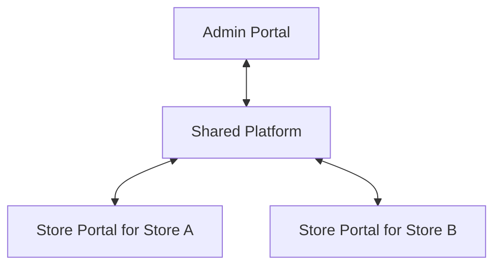

# Hardware Store Management System

An online system for independent hardware store businesses. A Platform Admin registers stores, controls their enabled modules, publishes announcements, and reviews centralized performance reports. Each store operates through its own Store Portal and starts with one Store Owner account.

Status: Planning baseline, version 0.1. Prepared on October 31, 2026, using Asia/Manila dates.

## Build documentation

| Document | Purpose |
| --- | --- |
| [Product requirements](docs/PRD.md) | Product scope, requirements, acceptance criteria, and release boundaries |
| [Architecture](docs/architecture.md) | Application boundaries, transaction handling, deployment, and API conventions |
| [Data model](docs/data-model.md) | Entities, relationships, constraints, and financial record structure |
| [Workflows and screens](docs/workflows.md) | Navigation, user journeys, state transitions, and error behavior |
| [Access control](docs/access-control.md) | Store isolation, administrator permissions, and module access rules |
| [Reporting](docs/reporting.md) | Shared metric definitions, costing, cash reconciliation, and worked examples |
| [Build plan and verification](docs/build-plan.md) | Delivery order, requirement coverage, test scenarios, and launch checks |
| [Decisions and research](docs/decisions-and-research.md) | Confirmed decisions, proposed defaults, open decisions, and primary sources |

Start with the PRD. Use the other documents when implementing its requirements. Requirement IDs such as `FR-09` connect the PRD to the build and verification plan.

## Product structure

The Shared Platform provides authentication, store isolation, module access, transaction storage, announcements, and common reporting calculations. A store can access only its own business data. Authorized platform reporting can aggregate across stores.

## Scope and decisions

Confirmed requirements include independent store owners, online operation for the first version, automatic creation of one initial owner account, future support for additional users, per-store module access, announcements, and centralized reporting.

The proposed first release covers products, inventory, purchasing, paid sales, returns, cash sessions, paid operating expenses, and reports. Customer credit, quotations, delivery management, and additional staff accounts are later increments. The domain model allows these additions without making them part of the first release.

Implementation defaults are explicitly marked in the decision register. Currency, fiscal document requirements, authentication provider, hosting, and backup policy need resolution at the gates listed there. Production fiscal use depends on a jurisdiction-specific review; the documentation does not assert tax certification.

## Repository status

The working repository contained no application files when this baseline was prepared. The requested source repository, [will3452/hardware-store](https://github.com/will3452/hardware-store), was cloned to `/private/tmp/hardware-store-import` and had no commits, branches, tags, or Markdown files when checked on October 31, 2026. There was no existing Markdown documentation to import.

These files are the initial documentation set. Application implementation follows the [build plan](docs/build-plan.md).
