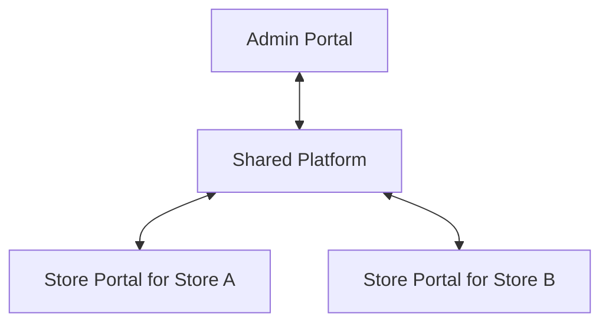

# Hardware Store Management System

An online system for independent hardware store businesses. A Platform Admin registers stores, controls their enabled modules, publishes announcements, and reviews centralized performance reports. Each store operates through its own Store Portal and starts with one Store Owner account.

Status: Laravel foundation and documentation baseline, version 0.2. Updated on October 31, 2026, using Asia/Manila dates. Laravel and MySQL are the chosen application stack; deployment targets Hostinger Web or Cloud hosting through hPanel.

## Build documentation

| Document | Purpose |
| --- | --- |
| [Product requirements](docs/PRD.md) | Product scope, requirements, acceptance criteria, and release boundaries |
| [Architecture](docs/architecture.md) | Application boundaries, transaction handling, deployment, and API conventions |
| [Data model](docs/data-model.md) | Entities, relationships, constraints, and financial record structure |
| [Workflows and screens](docs/workflows.md) | Navigation, user journeys, state transitions, and error behavior |
| [Access control](docs/access-control.md) | Store isolation, administrator permissions, and module access rules |
| [Reporting](docs/reporting.md) | Shared metric definitions, costing, cash reconciliation, and worked examples |
| [Build plan and verification](docs/build-plan.md) | Delivery order, requirement coverage, test scenarios, and launch checks |
| [Hostinger deployment](docs/hostinger-deployment.md) | Laravel runtime, public directory layout, build artifacts, cron, backups, and deployment checks |
| [Decisions and research](docs/decisions-and-research.md) | Confirmed decisions, proposed defaults, open decisions, and primary sources |

Start with the PRD. Use the other documents when implementing its requirements. Requirement IDs such as `FR-09` connect the PRD to the build and verification plan.

## Technology baseline

| Area | Baseline |
| --- | --- |
| Application | Laravel 13 modular monolith; PHP 8.3 minimum, PHP 8.4 production target after host verification |
| Interface | Official Livewire starter kit, Blade, Tailwind CSS, and compiled Vite assets |
| Authentication | Laravel session authentication and Fortify; invitation-based onboarding with public registration disabled |
| Database | MySQL 8.4 with InnoDB for local development and CI; Laravel `mysql` connection on the host's verified MySQL-compatible service |
| Authorization | Laravel middleware, policies, verified store context, scoped queries, and composite foreign keys |
| Background work | Database queue and cache, with short bounded processing driven by hPanel cron |
| Frontend build | Node and npm in local development or CI; deploy compiled static assets |
| Hosting | Hostinger Web or Cloud hosting through hPanel; no root access or persistent service supervisor assumed |

The [architecture](docs/architecture.md) defines the Laravel structure. The [deployment guide](docs/hostinger-deployment.md) identifies host capabilities to verify before choosing the exact plan or deploying. PostgreSQL row-level security and partial indexes are no longer part of this baseline.

Hostinger's Web and Cloud database service uses MariaDB internally. The application and local/CI tests use the `mysql` connection and MySQL 8.4; verify compatibility with the host's actual engine before deployment. See the [Hostinger database documentation](https://www.hostinger.com/support/1583226-which-database-management-system-is-used-at-hostinger/).

## Current foundation

Implemented: Laravel 13, Livewire and Fortify authentication, disabled public registration, email verification and password recovery screens, TOTP with mandatory administrator session proof, separate portal entry points, store memberships and module tables, fail-closed store context, job context cleanup, database sessions/cache/queue, and a bounded queue schedule. Domain identifiers use ULIDs. Public self-deletion is removed to preserve actor history.

Store registration and owner invitations, module configuration, announcements, audit workflows, purchasing, inventory, POS, cash, expenses, and reports remain the subsequent milestones in the [build plan](docs/build-plan.md). The portal entry screens do not imply those business modules are already implemented.

## Local development

Requirements: PHP 8.3 or newer with the required Laravel extensions and `pdo_mysql`, Composer 2, Node 24, npm, and Docker Compose. Production PHP targets 8.4 after host verification. Run these commands from the project directory on a fresh checkout:

```sh
composer install
cp .env.example .env
docker compose up -d --wait database
php artisan key:generate
php artisan migrate
npm ci
npm run build
php artisan app:create-admin
php artisan serve
```

Preserve an existing `.env` and application key when returning to an existing checkout. The administrator command prompts for a name, email, and hidden password; it refuses a second bootstrap. Sign in, confirm the password when requested, and enroll in two-factor authentication before opening the Admin Portal. There is no seeded production account or public sign-up route.

The development MySQL service binds only to `127.0.0.1:3307`. Its sample credentials in Compose and `.env.example` are development fixtures; configure separate private credentials on the host. Initial container setup creates `hardware_store` and the isolated `hardware_store_test` database. If reusing an older initialized development volume, create the test database with the supplied SQL through its local administrator connection.

Use `npm run dev` alongside `php artisan serve` when working on assets. To stop the local database without deleting its data, run `docker compose stop database`.

## Verification

```sh
composer ci:check
npm run build
```

The PHP checks run Pint, PHPStan, and the test suite. Tests use the separate `hardware_store_test` MySQL database and may reset its tables; keep that database isolated from merchant or development records. CI provides MySQL 8.4 and checks PHP 8.3 and 8.4. Hostinger account preflight, production performance, backup recovery, and the complete business scenarios remain release gates.

## Product structure



The Shared Platform provides authentication, store isolation, module access, transaction storage, announcements, and common reporting calculations. A store can access only its own business data. Authorized platform reporting can aggregate across stores.

## Scope and decisions

Confirmed requirements include independent store owners, online operation for the first version, automatic creation of one initial owner account, future support for additional users, per-store module access, announcements, and centralized reporting.

The proposed first release covers products, inventory, purchasing, paid sales, returns, cash sessions, paid operating expenses, and reports. Customer credit, quotations, delivery management, and additional staff accounts are later increments. The domain model allows these additions without making them part of the first release.

Implementation defaults are explicitly marked in the decision register. Currency, fiscal document requirements, the exact Hostinger plan and deployment layout, email delivery, and backup policy need resolution at the gates listed there. Production fiscal use depends on a jurisdiction-specific review; the documentation does not assert tax certification.

## Repository status

The working repository contained no application files when this baseline was prepared. The requested source repository, [will3452/hardware-store](https://github.com/will3452/hardware-store), was cloned to `/private/tmp/hardware-store-import` and had no commits, branches, tags, or Markdown files when checked on October 31, 2026. There was no existing Markdown documentation to import.

The initial documentation is now accompanied by a Laravel foundation. Implementation continues in the [build plan](docs/build-plan.md); Hostinger deployment uses the [deployment guide](docs/hostinger-deployment.md).
