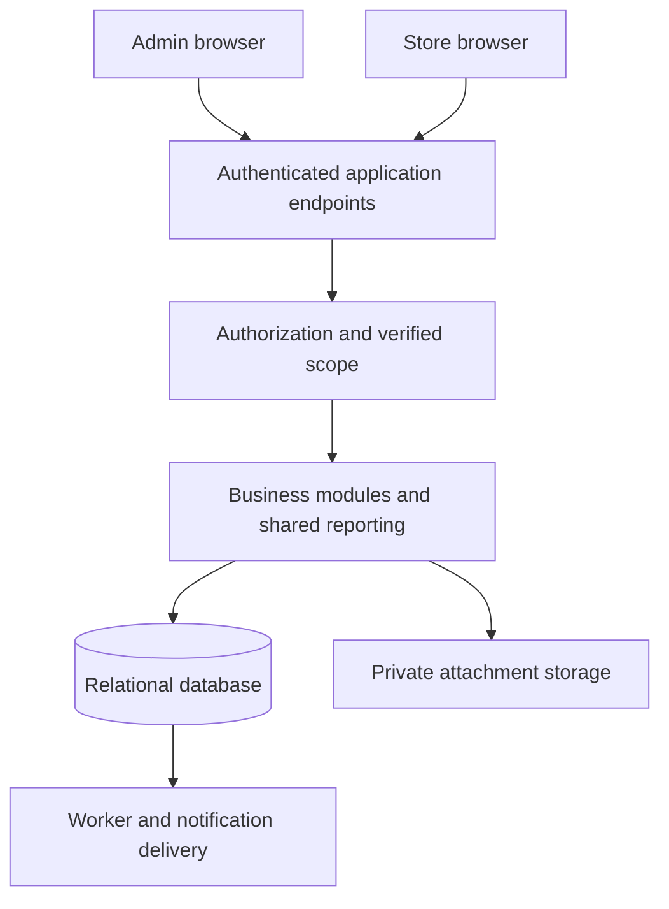

# Hardware Store System Architecture

This specification describes a proposed technical structure for the PRD. Use one application with two portal experiences, a shared business layer, and a transactional relational database. Keep the framework and infrastructure choices in [open decisions O-03 and O-04](decisions-and-research.md).

## Application boundaries

Portal paths are `/admin/*` and `/store/*`. They share authentication infrastructure but use separate authorization policies. An admin role grants platform actions; a Store Owner membership grants operations in its store. A person with both roles still uses the explicit scope of each request.

Use a modular monolith initially. A business transaction must not depend on distributed commits between sales, inventory, payments, and cash. A notification failure cannot roll back a committed sale or create a partial store.

## Business modules

| Module | Owns | Main dependencies |
| --- | --- | --- |
| Identity and membership | Activation, authentication integration, store membership, session invalidation | Authentication provider |
| Store administration | Store profile, lifecycle, owner provisioning | Identity, audit, notifications |
| Module access | Per-store entitlements and dependency validation | Store lifecycle, audit |
| Announcements | Audiences, publication windows, acknowledgements | Identity and verified store scope |
| Catalog | Products, categories, units, prices | Store scope |
| Inventory | Quantity ledger, balances, counts, weighted cost | Catalog, audit |
| Purchasing | Suppliers, purchase orders, receipts and reversals | Catalog, inventory |
| Sales and returns | Paid sales, payment recording, linked returns | Catalog, inventory, cash |
| Cash and expenses | Sessions, cash movements, paid expenses | Payment methods, audit |
| Reporting | Store and platform metric queries and CSV export | Posted records across modules |
| Platform operations | Outbox, jobs, private files, monitoring, backups | Infrastructure |

Business services enforce invariants regardless of the calling portal. Request handlers must not directly update stock balances, calculate their own profit formula, or bypass the module service to post a financial record.

## Store isolation

Every operational request obtains a verified store context from the authenticated identity and current membership. A client-supplied store ID selects a candidate scope; it is never proof of permission. Scope checks apply to list, search, detail, create, update, export, download, and background processing.

For shared PostgreSQL tables, use store-scoped foreign keys and row-level security with transaction-local store context. The normal application database role cannot bypass row security. Database connection reuse must clear context by transaction completion; include pooled-connection tests.

Central reporting uses a separately authorized query path. A tightly scoped reporting database role can read the required cross-store views and has no operational write permission. The platform profile and entitlement management path has distinct privileges on its own tables. Neither path is available to ordinary store requests.

Background jobs include verified ownership metadata and reauthorize when running. Cache keys, file paths, search indexes, notification payloads, and generated downloads carry store scope. Store owners never receive shared database backups or unrestricted object storage credentials.

## Command processing

A business command follows this sequence:

1. Authenticate; determine platform or store scope; verify membership and store status.
2. Verify action permission, module mode, and related resource ownership.
3. Validate request shape, bounded line counts, allowed units, totals, and reason fields.
4. Start a database transaction, reserve or retrieve the scoped idempotency key, and lock affected records.
5. Recheck mutable conditions inside the transaction, including module mode, store state, cash session, quantities, return limits, and document version.
6. Write the source document, snapshots, inventory and cash effects, audit event, and any outbox work.
7. Commit and return a durable document ID and posting status.

The command must either commit every required effect or none. Acquire product locks in a stable product-ID order. Sales and session closure take compatible session locks so a closed session cannot receive a late sale. Receipt corrections, concurrent returns, and stock counts use the same stock concurrency boundary.

Events are posted with server timestamps. User-entered supplier document dates and expense receipt dates are informational source dates. They cannot move a posting into an earlier cost or cash period. Expense reporting follows its explicit timestamp rule in [reporting](reporting.md).

## Idempotency and network interruption

Require an idempotency key for onboarding, posting a sale, return, receipt, adjustment, expense, reversal, or cash action. Bind it to the authenticated actor, scope, command name, and normalized payload hash.

- The same key and payload returns the existing outcome.
- The same key with a different payload returns a conflict.
- Concurrent use has one winner, protected by a unique database constraint.
- A rolled-back command has no successful outcome; a retry safely re-evaluates it.
- The client retains the submission ID until it knows the outcome and queries a status endpoint after an uncertain response.

Keep committed financial command keys with their source records. The client may retain an unposted draft locally, but it cannot queue completed sales offline or claim payment recording succeeded while disconnected.

## API conventions

These are route shapes, not a framework commitment. Define the executable API contract before implementing the corresponding milestone.

| Route family | Examples | Scope |
| --- | --- | --- |
| Platform | `/api/admin/stores`, `/api/admin/stores/{id}/modules`, `/api/admin/announcements` | Explicit platform permission |
| Store | `/api/store/products`, `/api/store/purchase-orders`, `/api/store/sales` | Verified selected store |
| Posting commands | `/api/store/sales/{id}/post`, `/api/store/returns/{id}/post` | Store, action, module, idempotency |
| Reports | `/api/store/reports/sales`, `/api/admin/reports/sales` | Different scope policies; one metric implementation |
| Recovery | `/api/commands/{submissionId}` | Only original actor and authorized scope |

Use stable machine-readable errors with `code`, safe `message`, field details where useful, and `request_id`. Use `401` for missing authentication, `403` for unavailable permissions or modules, `404` for resources outside the accessible scope, `409` for conflicting state or idempotency misuse, and `422` for invalid business input. Do not expose other-store names or record existence in errors.

List endpoints use bounded pagination and an allowlist of sort and filter fields. Draft updates use a version or equivalent optimistic concurrency check. Server totals override client totals; return computed totals for confirmation if a stale draft changes.

## Numbers and timestamps

Use exact decimal arithmetic throughout. Store money totals at currency precision, unit costs at six decimal places, and base quantities and conversion factors at six decimal places. The proposed pilot currency uses two decimal places. Do not represent business amounts with binary floating-point arithmetic.

Store UTC timestamps and an explicit IANA timezone for each store. Calendar date filters become half-open timestamp intervals. Central reports compare the same interval and as-of time; see [reporting](reporting.md).

## Notifications and private files

Create invitation delivery work in a transactional outbox. Retry delivery independently and expose status to the admin. Provider timeouts do not recreate a store or create multiple valid activation tokens. Generate a new invitation only through the explicit resend command.

Attachments are private, validated for size and permitted content type, and served after authorization through short-lived access. File upload finalization verifies store scope and record ownership. Orphan cleanup never deletes referenced files. Do not accept payment card data as an attachment or store payment credentials.

## Reporting architecture

Start with indexed queries over posted source records and ledgers. Both portals call the same reporting service with different authorized scopes. Every response includes interval, currency, included stores, and as-of or generated time.

If aggregates are introduced later, use them only after reconciliation against source records. Expose aggregation freshness, handle reversals, and include a deterministic rebuild path. Do not maintain unrelated admin and store calculations.

## Deployment and operations

Use separate development, staging, and production environments, each with distinct credentials and data. Version database migrations in the application repository. Test migrations against representative data and use compatible changes during deployment.

Log request IDs, verified scope, command IDs, errors, and posting duration without logging secrets. Monitor failed onboarding, notification retries, denied cross-store requests, stock invariant violations, reconciliation failures, and backup failures. Alerts go to a configured operational channel after an explicit delivery setup.

Automate database and private file backups, encrypt them, restrict restoration privileges, and rehearse recovery. Restoring one store from a shared backup must use an isolated recovery environment and scoped extraction, not overwrite live records for other stores. Final retention and recovery settings depend on O-06 and O-09.

## Deferred architecture

Offline operation requires a separate conflict, local security, payment, and fiscal numbering design. Multi-location operation requires location-scoped inventory and cash. Credit requires receivable and allocation ledgers. These are not solved by exposing dormant UI or adding unscoped columns during release one.
