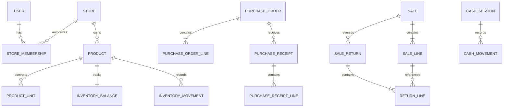

# Hardware Store Data Model

This is the logical persistence contract for the first release. Implement it with Laravel Eloquent and MySQL InnoDB migrations compatible with the verified Hostinger account version. Independent businesses are separated by Store. The model uses memberships for authorization and immutable posting records for inventory, sales, payments, and cash.

## Conventions and invariants

- Use generated ULIDs for domain primary keys with Laravel's `HasUlids` behavior. Keep human document numbers separate from IDs. Framework queue, cache, and session records may retain their framework identifier formats; their user references must match the application's user key type.
- Every store-owned table has `store_id`. A child references its parent through a composite foreign key containing `store_id`, preventing cross-store relationships.
- Financial totals use exact decimal amounts at currency precision. Quantity, conversion factor, inventory value, and cost use six decimal places. Round using the rules in [reporting](reporting.md).
- Store UTC `created_at` and server-controlled `posted_at` timestamps. Mutable drafts have `updated_at` and a concurrency `version`.
- Economic fields on posted records cannot be edited or deleted. Reversals and derived statuses do not rewrite their original snapshots.
- Maintain unique source-effect constraints so a document cannot post the same stock or cash effect twice.
- Financial records use one currency inherited from the Store and snapshotted on posting. Do not change the Store currency after its first posting.
- Historical actor IDs refer to retained identities, even after membership removal. Account anonymization must preserve required audit relationships under the agreed retention policy.

## Core relationships

The diagram omits scope columns for readability. All operational relationships remain store-scoped.

## Platform and identity tables

| Table | Essential fields | Constraints and purpose |
| --- | --- | --- |
| `stores` | `id`, `code`, `display_name`, structured address, `contact_email`, `contact_phone`, `currency`, `timezone`, `status`, `authorization_version` | Unique platform store code; lifecycle checks; currency locked after first posting |
| `users` | `id`, `name`, normalized `email`, `password`, `email_verified_at`, `remember_token`, `status`, Fortify two-factor fields | Laravel authenticatable identity; unique normalized email; hashed password and encrypted TOTP secret and recovery codes; no external identity provider required |
| `platform_user_permissions` | `user_id`, `permission`, assignment actor and time | Explicit platform actions independent of store membership |
| `store_memberships` | `store_id`, `user_id`, `role`, `status`, `activated_at`, `revoked_at` | Unique current user membership per store; at most one active owner per store in release one |
| `invitations` | `id`, `store_id`, `user_id` or verified target email, `purpose`, `token_hash`, `expires_at`, `accepted_at`, `revoked_at`, `delivery_status` | Single-use purpose-specific invitation; only one live invitation per owner provisioning or replacement operation |
| `store_modules` | `store_id`, `module_key`, `mode`, `version`, change actor and reason | Unique store and module key; valid dependency graph and modes |
| `announcements` | `id`, `title`, `body`, `audience_kind`, `state`, `publish_at`, `expire_at`, creator | `all_stores` or `selected_stores`; sanitized content; end after start |
| `announcement_targets` | `announcement_id`, `store_id` | Unique audience pair; only applicable for selected audience |
| `announcement_reads` | `announcement_id`, `store_id`, `user_id`, `read_at` | Unique acknowledgement per user and announcement; authorizes current audience before writing |

Invitation creation and owner activation do not make a pending Store operational until all required provisioning steps succeed. Replacing an owner revokes and activates memberships atomically after successor acceptance.

## Catalog and stock tables

| Table | Essential fields | Constraints and purpose |
| --- | --- | --- |
| `categories` | `id`, `store_id`, `name`, optional parent, archive state | Parent must be in the same store; no category cycles |
| `products` | `id`, `store_id`, `sku`, optional barcode, `name`, brand, variant attributes, `category_id`, `base_unit`, `unit_dimension`, `allows_fraction`, `selling_price`, `reorder_level`, archive state | SKU unique per store; nonempty barcode unique per store; immutable base unit after movements |
| `product_units` | `id`, `store_id`, `product_id`, `label`, `factor_to_base`, `allowed_for_purchase`, `allowed_for_sale`, `version`, archive state | Positive factor; same product dimension; used versions immutable; base unit factor is one |
| `inventory_balances` | `store_id`, `product_id`, `quantity`, `inventory_value`, `average_cost`, `cost_status`, `version`, `last_movement_id` | Unique store and product; quantity and value nonnegative; zero quantity implies zero value |
| `inventory_movements` | `id`, `store_id`, `product_id`, `movement_type`, signed `quantity_delta`, signed `value_delta`, `quantity_before`, `value_before`, `quantity_after`, `value_after`, `unit_cost_snapshot`, `source_type`, `source_id`, `source_line_id`, `source_effect`, `actor_id`, `posted_at`, reason | Append-only; typed source ownership validation; unique source effect; quantity and value reconcile to balance |
| `stock_counts` | `id`, `store_id`, `state`, `snapshot_at`, creator, posting actor and time | `draft`, `posted`, `cancelled`; no silent posting against a changed balance version |
| `stock_count_lines` | count ID, store and product, snapshot quantity and balance version, counted quantity, cost snapshot, reason | Unique product per count; count delta normalized to base unit |

Implement known movement sources with explicit nullable source foreign keys, store-scoped composite references, and a constraint selecting exactly one valid source for the movement type. The logical `source_type` and `source_id` above describe the source relationship, not permission to persist an unchecked polymorphic reference. Do not depend on database triggers or elevated privileges unavailable on the selected Hostinger plan. Application validation supplements these constraints and does not replace source ownership integrity.

Movement types include `opening`, `receipt`, `receipt_reversal`, `sale`, `return_restock`, `count_surplus`, `count_shortage`, and `damage`. Positive count differences require a known average cost or an explicitly entered cost when no cost basis exists. Zero cost is allowed only when explicitly marked known and justified; null cost is not zero.

Damage from a customer return creates a `return_restock` and a linked `damage` movement with equal and opposite quantity and original cost value in the same transaction. This leaves sellable inventory unchanged while preserving the returned quantity and loss.

## Purchasing tables

| Table | Essential fields | Constraints and purpose |
| --- | --- | --- |
| `suppliers` | `id`, `store_id`, `name`, contact and address, archive state | No cross-store supplier sharing by default |
| `purchase_orders` | `id`, `store_id`, document number, `supplier_id`, `state`, supplier reference, source document date, placed time, creator | `draft`, `ordered`, `partially_received`, `received`, `closed`, `cancelled`; document number unique by store and type |
| `purchase_order_lines` | order ID, store and product, quantity entered, unit ID and factor snapshot, ordered base quantity, base cost estimate, product snapshot | Positive quantity; received totals derived from posted receipts and eligible reversals |
| `purchase_receipts` | `id`, `store_id`, document number, `purchase_order_id`, supplier delivery reference, `state`, `posted_at`, actor | Every release-one receipt references a placed order; direct receiving creates or selects an order first |
| `purchase_receipt_lines` | receipt ID, store, PO line ID, product snapshot, entered quantity and unit factor, base quantity, base unit acquisition cost, inventory value received | No over-receiving; cost required; one consolidated movement per receipt line |
| `receipt_reversals` | `id`, `store_id`, `receipt_id`, reason, actor, `posted_at` | Full receipt reversal only in release one; one reversal per receipt |

A receipt reversal is allowed only when that receipt remains the latest movement for every affected product and the exact original quantity and value can be removed. Acquire locks and restore the recorded previous balances. After downstream sales or other stock movement, use an explicitly reviewed correction process rather than rewriting a receipt. Formal supplier returns and historical cost corrections require later scope; the first release rejects unsupported correction commands with an explanation.

## Sales and payment tables

| Table | Essential fields | Constraints and purpose |
| --- | --- | --- |
| `sales` | `id`, `store_id`, document number, `state`, `currency`, `cash_session_id`, optional customer display snapshot, `gross_ex_tax`, `discount_ex_tax`, `net_ex_tax`, `tax_total`, `total_due`, `posted_at`, actor | `draft`, `posted`, `cancelled` before posting; posted financial fields immutable; payment sum equals total due |
| `sale_lines` | sale ID, store and product, line position, SKU/name/unit snapshots, entered quantity, factor, base quantity, unit selling price, discount details, tax snapshot, line totals, unit cost and `cogs_amount` | Positive quantity; bounded discounts; six-decimal cost extension; unique line position |
| `sale_returns` | `id`, `store_id`, document number, `sale_id`, `cash_session_id`, reason, totals, state, posting actor and time | `draft`, `posted`, `cancelled` before posting; original sale required |
| `return_lines` | return ID, store, original sale line ID, returned base quantity, disposition, reversal amount and cost snapshots | Cumulative returns no more than original sold quantity; partial amount allocation uses original snapshots |
| `payment_methods` | `id`, `store_id`, `name`, `kind`, `reference_required`, enabled state | Kind: cash, card, bank, e-wallet, or other confirmed noncash; no release-one credit method |
| `payments` | `id`, `store_id`, `sale_id` or `return_id`, `direction`, `method_id`, amount, tendered amount and change for cash, external reference, confirmed actor and time | Exactly one applicable source; amounts positive; `collection` or `refund`; posted with source document |

Cash `amount` is the applied cash received after change, not the tendered banknotes. Noncash records are confirmations of external payments or refunds, not processor transactions. Do not store card numbers, security codes, or provider secrets.

Tax snapshots include treatment, rate or code, inclusive or exclusive price mode, taxable basis, and computed tax. Exact statutory fields and fiscal numbering remain gated by O-02. A provisional printable sale copy is not described as a certified fiscal invoice.

## Cash and expense tables

| Table | Essential fields | Constraints and purpose |
| --- | --- | --- |
| `cash_sessions` | `id`, `store_id`, sequence, `state`, `purpose`, `opening_float`, opened actor and time, closing expected/count/variance, close note and actor/time | One open session per store; purpose `normal` or `resolution`; closed count immutable |
| `cash_movements` | `id`, `store_id`, `cash_session_id`, `direction`, positive amount, `kind`, typed source ID, actor, posting time and reason | Kinds: sale, refund, expense, expense reversal, manual in, manual out; one movement per source effect; opening float is not duplicated here |
| `expense_categories` | `id`, `store_id`, `name`, archive state | Operating categories only; exclude stock acquisition and owner drawings |
| `expenses` | `id`, `store_id`, document number, category, description, total amount, payment method, optional external reference, source receipt date, posting time and actor, optional session ID | Paid on posting; cash requires current open session; no unpaid expense state |
| `expense_reversals` | `id`, `store_id`, original expense ID, reason, amount, payment method, optional current session ID, posted actor and time | Full reversal only initially; one reversal per original expense; do not rewrite old session |

A recorded expense amount includes any unrecovered tax under the initial operational model. Recovered purchase tax and tax-adjusted expense treatment need O-02 and an explicit policy. Avoid deducting the same expense through both manual cash out and an expense record: a linked expense owns its cash movement.

## Infrastructure records

| Table | Essential fields | Constraints and purpose |
| --- | --- | --- |
| `document_sequences` | store, document type, numbering period, next value | Allocate atomically; never promise gapless fiscal numbering before O-02 |
| `command_requests` | scope type and ID, actor, command name, idempotency key, payload hash, source record ID, committed outcome | Unique scoped command key; financial outcomes retained with documents |
| `audit_events` | store scope if applicable, actor, action, entity type and ID, request ID, sanitized changes, time | Append-only; platform and store event visibility separated |
| `outbox_messages` | message type, scoped source, delivery payload reference, attempts, next attempt, state | Written in source transaction; delivery retries do not repost source work |
| `attachments` | store, owning entity, private object key, checksum, type, size, created actor/time | Private storage; ownership verified on upload finalization and download |

Add Laravel's database session, queue, failed-job, cache, and cache-lock tables when their drivers are configured. Treat their stored payloads as sensitive. Database jobs and outbox records must establish and clear verified scope per execution; their table presence alone does not grant tenant access.

## Required indexes and constraints

Create indexes for store and posting time on sales, returns, receipts, expenses, cash movements, inventory movements, and audit events. Add store and product indexes for stock lookup and movement history. Index current membership and current module lookup. Index announcement publication windows and target membership.

MySQL does not use the earlier PostgreSQL partial-index design. Use nullable generated guard columns and unique indexes for conditional uniqueness, verified on the actual MySQL version:

- Cash session `open_guard` is `1` when state is open and `NULL` otherwise; a unique index on `(store_id, open_guard)` permits only one open session.
- Membership `active_owner_guard` is `1` only for an active owner and `NULL` otherwise; a unique index on `(store_id, active_owner_guard)` permits only one active owner.
- Membership `current_user_guard` is numeric `1` for pending or active membership and `NULL` otherwise. A unique index on `(store_id, user_id, current_user_guard)` preserves revoked history while preventing duplicate current memberships. Numeric guards avoid generated string expressions that can depend on SQL padding modes.
- Normalize an absent barcode to `NULL`, not an empty string, before enforcing `(store_id, barcode)` uniqueness.

Use ordinary stored columns for composite foreign key references; the generated guards are uniqueness aids, not foreign key targets. Add explicit parent indexes such as `(store_id, id)` and use matching column types, lengths, collations, and InnoDB engines on both sides. Use short, database-unique constraint names for compatibility across host versions.

Add unique constraints for store and SKU, document type and document number, each typed source effect, and command key. Totals, quantities, state transitions, and cross-record cumulative return limits must also be enforced in transactional services; some require locks rather than a row-level check constraint. Test migrations and these concurrency rules on MySQL, not only SQLite.

Use exact `DECIMAL` columns for values and preserve decimal strings through Eloquent. The proposed amounts use `DECIMAL(20,2)` and quantities, factors, and cost use `DECIMAL(20,6)`; validate maximum input and multiplication ranges before persistence. Configure strict SQL behavior and `utf8mb4`, with consistent identifier collations on foreign keys. Record any host-imposed engine or SQL-mode limitation before migration design is finalized.

## Later model additions

Do not add active placeholder behavior for these in release one. Their design requires a separate increment:

- Customer records, credit agreements, receivable entries, payment allocations, refunds against credit balances, and aging.
- Quotations, sales orders, reservation quantities, fulfillment, and deposits.
- Delivery stops, schedules, proof of delivery, and delivery charges.
- Locations, stock transfers within a business, and location-level cash sessions.
- Supplier invoices, payable entries, and supplier payment allocation.
- Multiple staff permissions and assignment history.

Every later store-owned table must join the isolation inventory and its access tests before release.
