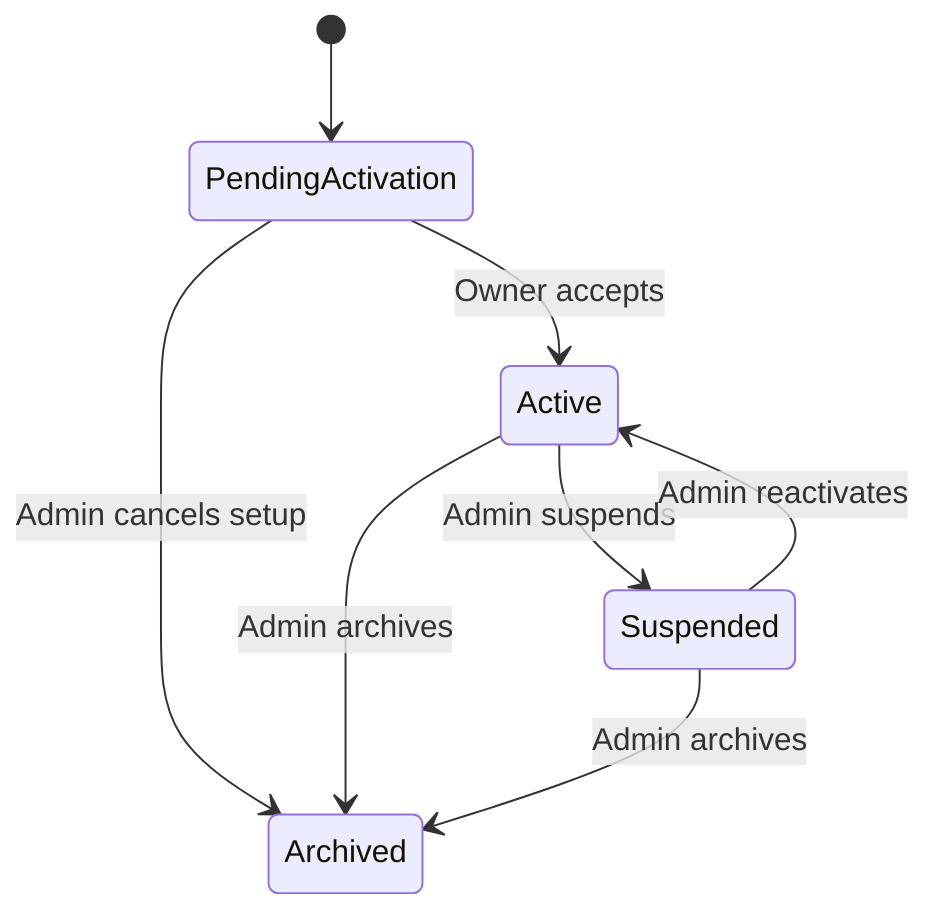
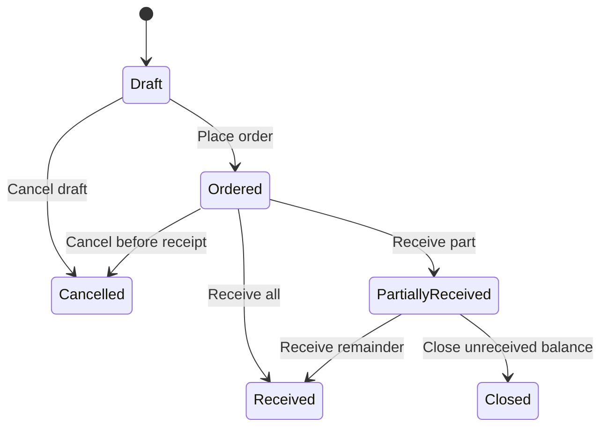

# Hardware Store Workflows and Screens

The screens below implement the first-release PRD. Keep product language consistent: Store, Store Owner, Platform Admin, Admin Portal, and Store Portal. The system is online; a locally retained draft is not a posted transaction.

Implement the portal interface with the proposed Laravel Livewire and Blade baseline. Login, recovery, verification, and TOTP use Fortify. Public registration and starter-kit team creation are disabled; store onboarding remains an admin-controlled invitation workflow. Reauthorize server actions even when a Livewire component already rendered the requested record.

## Navigation

| Portal | Area | Main screens |
| --- | --- | --- |
| Admin | Overview | Platform dashboard and store performance summary |
| Admin | Stores | Store list, registration, store profile, owner activation status, lifecycle history |
| Admin | Feature Access | Per-store module configuration, dependency review, change history |
| Admin | Announcements | Draft list, editor, audience, schedule, publication preview |
| Admin | Reports | Store selector, combined metrics, per-store comparison, CSV export |
| Admin | Activity | Authorized platform and store audit views |
| Store | Home | Current cash session, addressed announcements, report cards when available |
| Store | Sales | Checkout, sales history, sale detail, linked returns |
| Store | Products | Product list, product editor, units and pricing |
| Store | Inventory | Stock view, opening stock, movement history, count and adjustment |
| Store | Purchasing | Suppliers, purchase orders, receiving, receipt history |
| Store | Cash and Expenses | Session opening and closing, cash movements, paid expense history |
| Store | Reports | Sales, collections, profit estimate, products, inventory, cash, CSV export |
| Store | Settings | Store contact and address, profile, password and recovery entry points |

Hide unavailable new-work actions and explain restrictions on historical document screens. A store picker appears only for an identity with more than one authorized store. General staff management, credit accounts, quotations, and delivery screens do not appear in release one.

## Store onboarding

1. Admin selects Add Store and enters identity, physical address, owner email, contact information, currency, timezone, and initial modules.
2. The form displays the module dependencies and any existing-identity match. The admin explicitly confirms reuse of an existing identity rather than silently attaching by email.
3. The server validates uniqueness and commits the pending store, owner association, invitation, module configuration, audit event, and invitation outbox item.
4. The store detail shows Pending Activation and delivery state. A failed email can be retried without recreating the store.
5. Owner opens the invitation, authenticates or sets their password, and accepts the intended store membership.
6. The server consumes the invitation once, activates the membership and store, and records the activation.
7. The owner sees setup tasks: verify profile, create products and units, configure confirmed payment methods, enter opening stock or receive purchases, and open a cash session.

Expired invitation: show expiry and the recovery path without revealing an invitation secret. Resend: revoke the earlier token and send a new invitation for the same pending store. Duplicate browser submission: return the existing store. Incomplete provisioning: no operational access is possible until the entire provisioning operation is valid.

## Owner replacement and lifecycle

Admin invites a successor from the store profile. Existing access remains unchanged until the successor authenticates and accepts. Acceptance atomically swaps the active owner membership and revokes the former owner's store sessions. Show the change and effective time in history.

An active store can be suspended and later reactivated. Archive removes operational access and retains records. A suspended or archived store cannot accept an operational owner activation until its lifecycle permits access. The interface requires a reason for suspension, archive, and owner replacement. Platform reports retain historical postings across these changes.

Exceptional restoration of an archived store is an audited administrative operation, not an ordinary state button in release one.

## Feature access changes

1. Admin opens the store's Feature Access screen.
2. The screen shows each module's mode, dependencies, and open work that affects disabling.
3. Admin selects a change and enters a reason. The server evaluates the complete resulting configuration.
4. If history or unfinished work requires resolution access, show Restricted mode and its permitted actions.
5. Save the configuration and audit event atomically, increment the authorization version, and refresh relevant store navigation.

A store page already open cannot submit new work after access is withdrawn. The API returns a module state error and preserves any local draft as unposted. The exact module modes and resolution actions are in [access control](access-control.md).

## Announcements

Admin saves a draft, selects All Stores or named stores, sets publication and optional expiration, previews the content, and publishes or schedules it. Publication eligibility is evaluated from state, audience, and timestamps at read time; a delayed background job cannot expose an expired or premature announcement.

The owner sees the announcement title, content, publication time, and optional read acknowledgement. All-store announcements include stores registered while the announcement is active. Selected-store audiences remain the selected set. Withdrawal removes the announcement from store views but keeps administrative history.

## Product setup and opening inventory

Owner creates a product with a unique SKU and base unit, such as piece, meter, or kilogram. Each sellable size or material variant is a separate SKU. Add product-specific purchase or sales units, such as a box of 100 pieces or a roll of 50 meters.

The editor shows the conversion in plain language and previews a sample quantity. Once a unit version has been used, create a replacement version for future transactions instead of altering history. Archive obsolete products; historical sale and receipt details remain readable.

Opening inventory is entered once before the product's first movement, with quantity and a known unit cost or total value. For an existing product with movements, use a physical count or supported adjustment with a reason. Do not disguise later stock changes as opening stock.

## Purchase order and receiving

1. Owner selects a supplier and creates a draft purchase order with products, quantities, purchase units, and estimated costs.
2. Place Order validates the order and gives it an Ordered state. Stock remains unchanged.
3. Receive opens the remaining quantities. The owner records actual quantities, acquisition costs, and supplier delivery reference.
4. A posting preview shows entered units, base quantities, and the inventory value to add.
5. Post Receipt atomically adds inventory movements and balances and updates the order's derived received quantities.
6. The order becomes Partially Received or Received. Close Remaining records an explicit short-close reason.

Amending a placed order records the previous version and reason and cannot reduce ordered quantity below already received quantity. Posted receipts retain their snapshots. An eligible full receipt reversal is allowed only under the latest-movement rule in the [data model](data-model.md); otherwise show why reversal is blocked. Formal supplier return and downstream cost correction are later workflows.

## Cash opening and checkout

1. Owner opens a cash session and enters the counted opening float. The server prevents a second open session.
2. Owner scans or searches products, enters permitted quantities, and applies line discounts. The cart shows normalized stock usage and server-computed totals.
3. Owner selects payment methods. Cash shows tendered amount and change. Noncash requires confirmation and the configured reference.
4. Complete Sale uses one submission ID. The server checks current stock, module access, session state, and full payment inside the posting transaction.
5. On success, show the durable sale number, payment breakdown, and printable sale copy. Clear the cart only after confirmed success.

No stock is reserved by a draft cart in release one. If another transaction consumes the stock first, keep the cart and show available quantities for correction. A stale price is recalculated for owner review before posting; it is not silently substituted after the customer payment amount is confirmed.

On response timeout, show Outcome Unknown and query the submission status. Retry with the same submission ID. Do not advise the owner to recreate the sale until the original outcome is known. A disconnected browser shows an online requirement and keeps only an unposted draft.

## Customer return and refund

1. Owner opens the original sale and chooses Return Items.
2. The screen shows original quantities, earlier returns, refundable quantities, original discounted amounts, and original payment details.
3. Owner enters quantities, reason, sellable or damaged disposition, and confirmed refund method. Different refund methods require a recorded reason.
4. Preview shows refund, tax reversal, inventory effects, and any damage loss.
5. Post Return locks the original sale lines and affected stock, checks the refundable remainder and current cash session, and posts all effects once.

If a cash refund would make expected drawer cash negative, require a legitimate cash addition or another confirmed refund method. If an external refund has not been completed, preserve the draft; do not mark it paid. The system records the confirmation but does not initiate processor refunds in release one.

## Stock count and damage

Owner opens a count with a recorded balance version, enters counted quantities, and reviews differences and reasons. Posting rechecks that no movement invalidated the count snapshot. If stock changed during counting, require a recount or an explicitly reconciled count; do not overwrite the new balance.

A negative difference records a shortage and cost loss. A positive difference adds stock with a valid cost basis and reports the gain separately. Damage removes stock and records the loss. Every adjustment links to a source document and actor. No direct balance editing screen exists.

## Operating expense and correction

Owner selects an operating category, enters amount, source receipt date, description, confirmed payment method, and optional attachment. A cash expense shows the current session and creates one linked cash-out movement; a noncash expense has no drawer effect.

A posted expense is corrected by a full reversal with a reason, followed by a new expense when needed. A cash reversal uses the current open session, even when the original expense belonged to an earlier closed session. The earlier closing count remains unchanged. Inventory purchases and owner drawings are rejected as operating categories.

## Cash close

Owner resolves uncertain submissions, reviews the session's sales, refunds, expenses, and manual movements, enters actual counted cash, and explains any variance. The server serializes closing against in-flight posting and stores the final reconciliation.

After closure, the session is read-only. A new session starts with a newly counted float. A midnight boundary does not automatically close or duplicate a session. Transactions after midnight appear on their actual posting date, while the session report spans the full session.

## Reports and exports

Owner chooses a report and date interval; the platform determines the verified store scope. Admin chooses one or more authorized stores. Both views show currency, timezone, interval, as-of time, and filters.

Use separate labels for Net Sales, Collections, Gross Profit, Paid Operating Expenses, Recorded Inventory Losses, and Estimated Operating Profit. The metric help text follows [reporting](reporting.md). Export matches the screen scope and metadata. Where a filtered result is empty, show a useful empty state rather than a fabricated trend.

## Common interface states

| State | Required behavior |
| --- | --- |
| Loading | Keep current context visible; prevent duplicate submission without implying success |
| Validation error | Keep input; identify the field and correction |
| Conflict | Explain the changed quantity, version, module, or session and offer a safe refresh |
| Unauthorized resource | Show a generic inaccessible state without other-store details |
| Session expired | Reauthenticate before resuming; never replay a mutation automatically |
| No data | Explain the first valid action for the area |
| Restricted module | Show historical documents and only permitted resolution actions |
| Uncertain posting | Retain submission ID and recover outcome before a new attempt |

Use visible labels, keyboard navigation, readable contrast, and clear status text. Financial amounts include currency; quantity fields include their unit. A printed document retains the posted snapshots rather than showing a later product rename or current price.
